<div align="center">


# Huddle

**Group scheduling without the email thread.**
Propose a few times, share one link, and let everyone vote with no account needed.


[Features](#features) · [Design](#design) · [Screenshots](#screenshots) · [Tech stack](#tech-stack) · [Getting started](#getting-started)

</div>

<picture>
  <source media="(prefers-color-scheme: dark)" srcset="readme/hero-dark.png">
  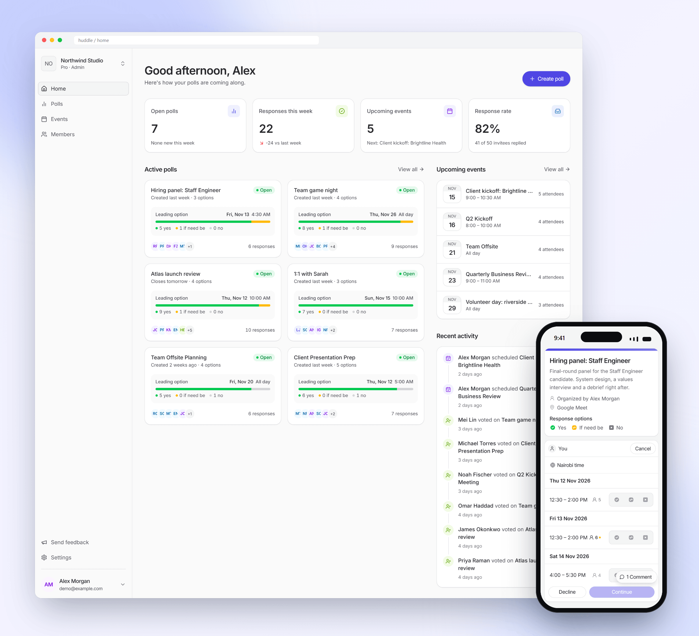
</picture>

## Overview

Huddle replaces the "what time works for everyone?" email thread. An organizer proposes dates or time slots, invitees mark each one *yes*, *if need be* or *no* from a public link, and the organizer finalizes the winner and sends calendar invites. Teams get shared **spaces** with members, roles and a home dashboard that tracks open polls, response rates and upcoming events.

It is a production-grade Next.js monorepo (web app, landing site, docs, email templates) that runs as a hosted SaaS with Stripe billing or self-hosted from a single Docker image.

## Try the demo

Run it locally (see [Getting started](#getting-started)), open `/login` and click **Try the demo**. You land in the *Northwind Studio* workspace as Alex Morgan, with 27 polls, 160+ participants, 580 votes, comments and 18 scheduled events, all dated relative to today.

The button only renders when `DEMO_LOGIN_ENABLED=true`, and the sign-in runs in a server action, so the demo password never reaches the browser. To see the invitee side, open any poll's share link in a private window.

## Features

### Voting that works for people who will never sign up

Invitees open a link, pick their name or type a new one, and tap yes / if need be / no for each option. Times are shown in their own time zone, the grid becomes a stacked list on phones, and the most popular option is highlighted as votes come in.

<picture>
  <source media="(prefers-color-scheme: dark)" srcset="readme/invite-dark.png">
  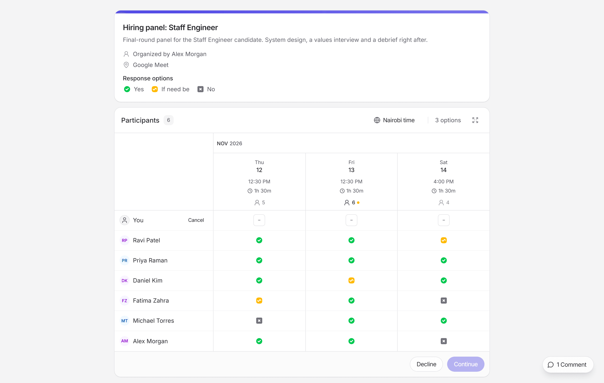
</picture>

### Every response, per person

The organizer's view lists each participant with their full availability and activity, so following up with the one person who said "no" to everything takes a click.

<picture>
  <source media="(prefers-color-scheme: dark)" srcset="readme/responses-dark.png">
  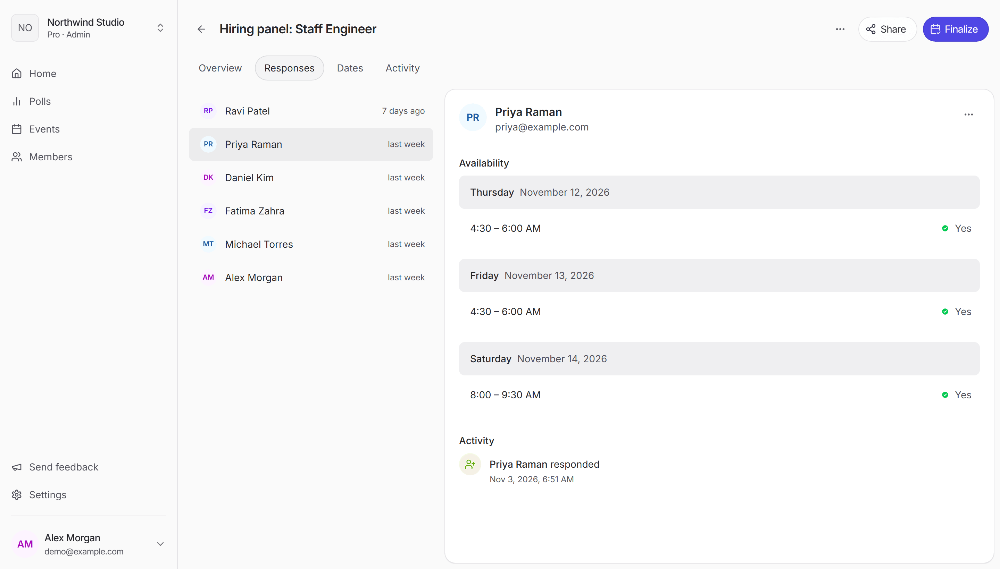
</picture>

### From poll to calendar event

Finalize the winning option and Huddle creates an event and emails `.ics` invites to everyone. The events view groups upcoming, past and cancelled meetings by day and refreshes when the tab regains focus.

<picture>
  <source media="(prefers-color-scheme: dark)" srcset="readme/events-dark.png">
  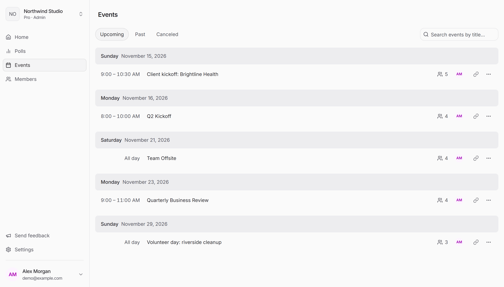
</picture>

### Fast poll creation

Pick dates on a month grid or a week view, set a default duration, add per-day time slots, and choose privacy rules (require email, hide names, hide votes until voted, comments, vote options) before sharing.

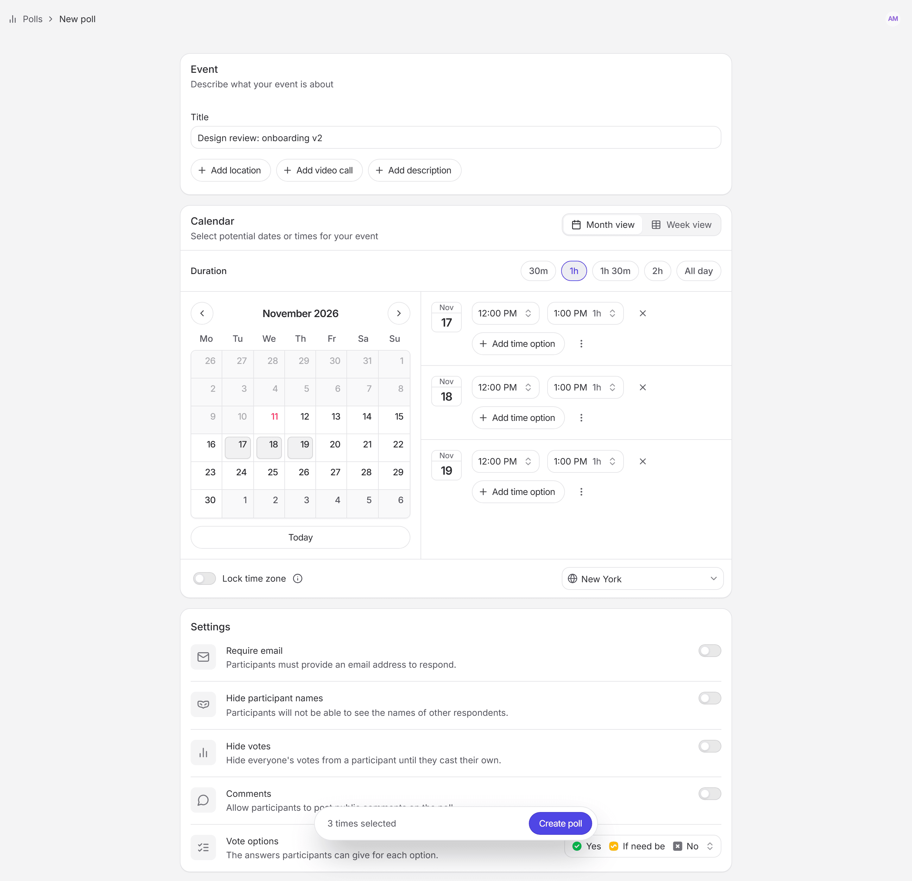

### Everything else

| Area | What you get |
|---|---|
| **Home dashboard** | Open polls, responses this week vs last, upcoming events, invite response rate, the leading option per active poll and a recent-activity feed. Each block streams in its own Suspense boundary |
| **Spaces** | Members, admin/member roles and seat limits; CASL permissions enforced on server and client |
| **Sign-in** | Email OTP, Google, Microsoft or any OIDC provider (Better Auth), plus guest sessions |
| **Integrations** | Calendar connections, Google Meet / Zoom / Teams / Webex links, webhooks and a REST API with API keys |
| **Email** | React Email templates over SMTP or Amazon SES, sent through a queue |
| **i18n** | 16 locales via i18next with ICU plurals |
| **Self-hosting** | Registration and allowed-email policies, moderation, maintenance mode, custom name, colours and logo |

## Design

The UI is built from a shared component library (`packages/ui`) on Base UI primitives and Tailwind CSS 4. Tokens live in one stylesheet, `packages/tailwind-config/shared-styles.css`: an indigo primary (`indigo-600` light, `indigo-500` dark), a zinc neutral scale, a single `--radius` of 0.625 rem, and Inter for type.

- **White-label by design.** `--primary` reads from an overridable variable, so a self-hosted instance can set its own brand colour and every button, focus ring and chart picks it up.
- **Dark mode is a first-class theme.** The token sheet redefines surfaces, borders and the primary for dark, so the voting grid and charts stay legible without per-component overrides.
- **One idea, two layouts.** The availability grid on desktop becomes a stacked list with large tap targets on mobile, and the sidebar collapses into a sheet.
- **Streaming instead of spinners.** The shell renders immediately and each data block fills in under its own skeleton.
- **Accessibility is tested.** A Playwright suite runs axe-core against key pages for WCAG 2.1 A/AA, with reduced motion emulated so the contrast checks are deterministic.
- **Calm states.** Every list has an empty state with a next step, and destructive actions confirm in a dialog.

<p align="center">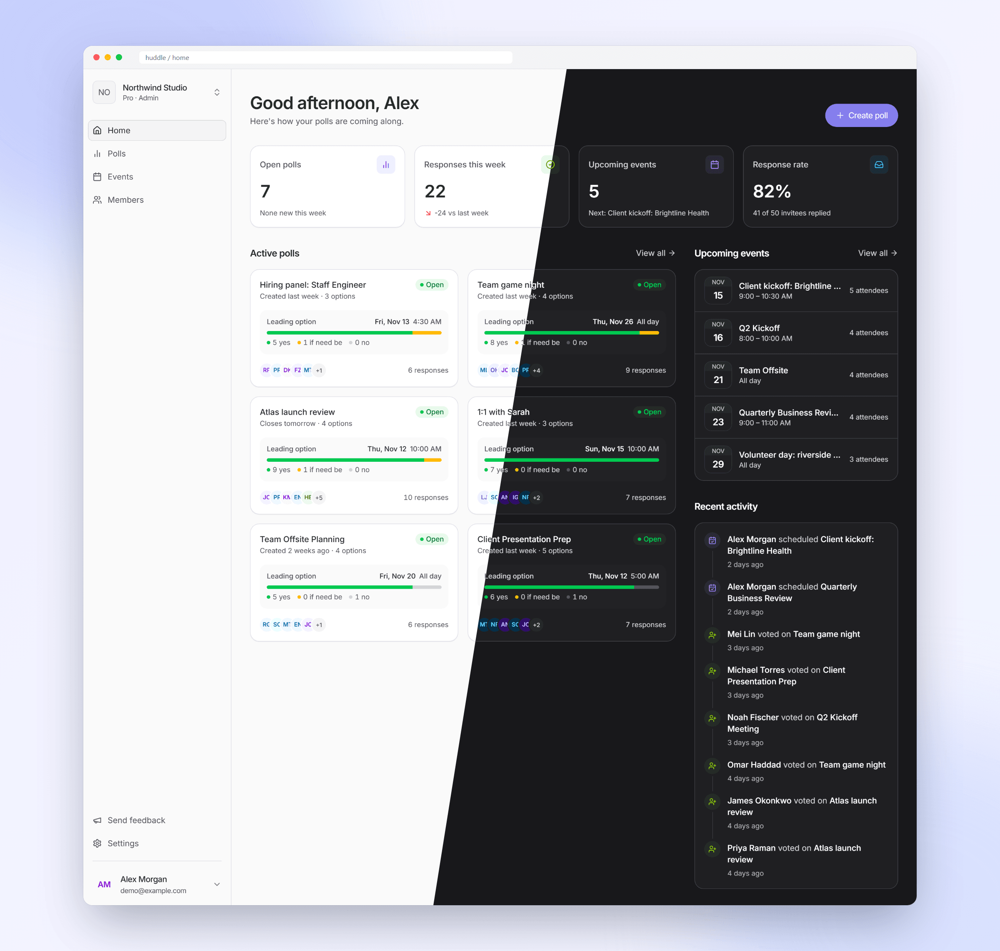</p>

<picture>
  <source media="(prefers-color-scheme: dark)" srcset="readme/mobile-dark.png">
  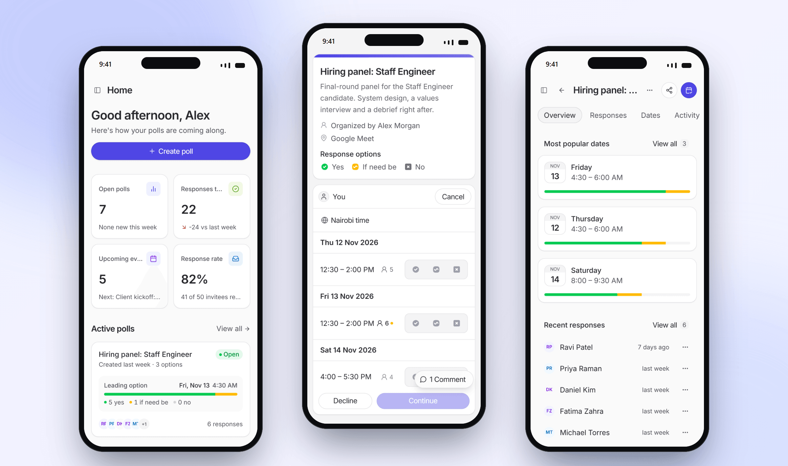
</picture>

## Screenshots

<table>
  <tr>
    <td width="50%">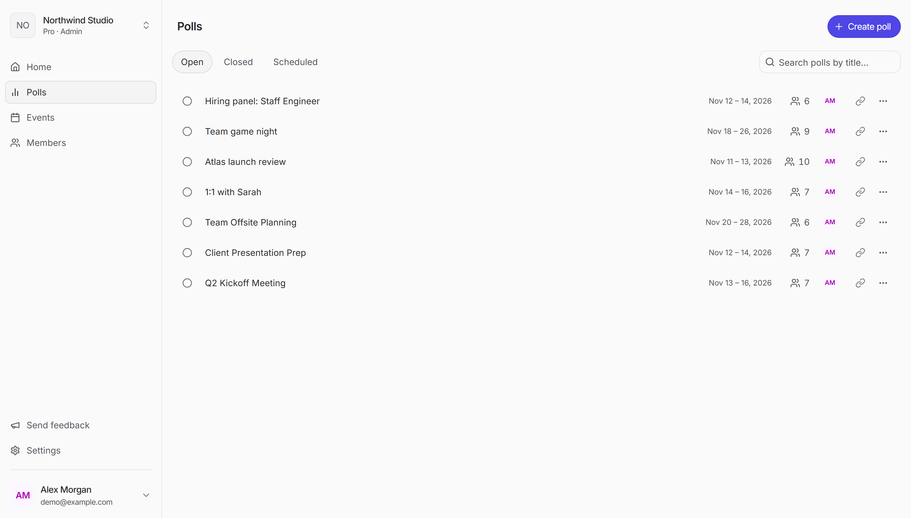<br><sub><b>Polls</b>: open, closed and scheduled, with search and quick share links</sub></td>
    <td width="50%">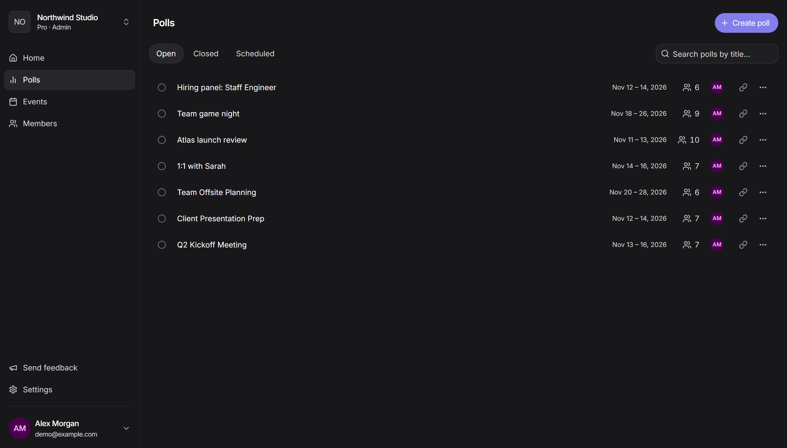<br><sub><b>Polls</b> in dark mode</sub></td>
  </tr>
  <tr>
    <td width="50%">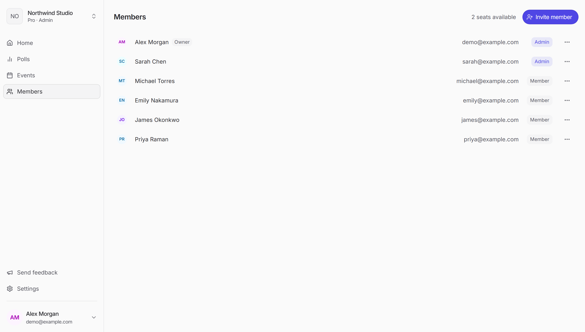<br><sub><b>Members</b>: roles and seat usage for the space</sub></td>
    <td width="50%">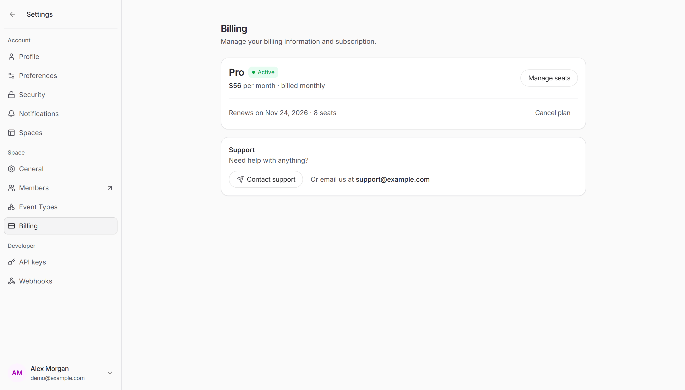<br><sub><b>Billing</b>: plan, seats and renewal (cloud mode)</sub></td>
  </tr>
  <tr>
    <td width="50%">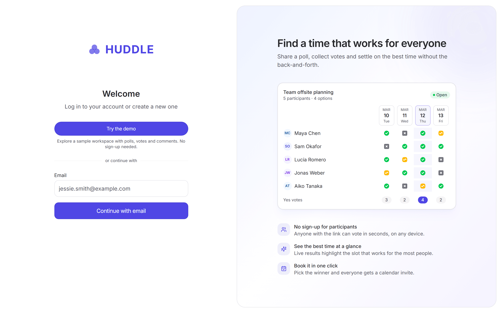<br><sub><b>Login</b> with the demo button and a live product preview</sub></td>
    <td width="50%">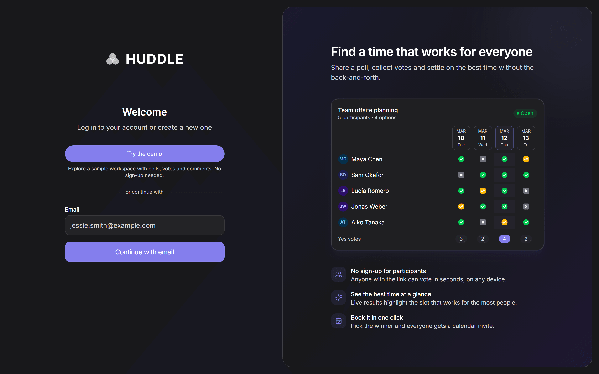<br><sub><b>Login</b> in dark mode</sub></td>
  </tr>
</table>

## Tech stack

| Layer | Technology | Why |
|---|---|---|
| Framework | Next.js 16.4 (App Router, server actions), React 19.2 | Streaming server components and actions without a separate API for the UI |
| Language | TypeScript 6 | Strict types from the Prisma schema to the components |
| Mutations | next-safe-action 8, Zod 4 | Every action has a validated input schema and an authenticated context |
| Server logic | Effect 4 | Typed errors and swappable dependencies for writes that call out (email, billing, webhooks) |
| Data | PostgreSQL, Prisma 7.8 (`@prisma/adapter-pg`) | Schema split per model, migrations in the repo |
| Auth | Better Auth 1.6, CASL | Sessions, OTP and SSO; one permission model on server and client |
| UI | Tailwind CSS 4, Base UI in `packages/ui`, TanStack Query 5, react-hook-form | Owned components and themable tokens |
| i18n | i18next 26 | 16 locales with ICU plurals |
| Email | React Email, SMTP or SES | Templates previewed and tested like components |
| Billing | Stripe (cloud mode only) | Seats-based plans; removed entirely when self-hosted |
| Tooling | pnpm workspaces, Turborepo, Biome, Oxlint, Vitest 4, Playwright | Fast lint/format, cached builds, unit + end-to-end tests |

## Architecture

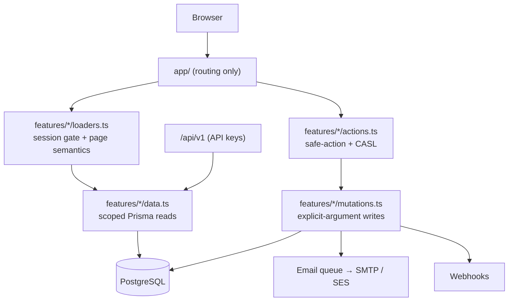

The web app enforces a strict layering, `app → features → components → lib`, checked by `pnpm check:structure` and Biome import rules.

- **Reads** go through `loaders.ts`, which resolve the session and redirect when needed, then call parameterized `data.ts` queries that carry the tenant scope in every `where` clause. Pages cannot import `data.ts` directly, so the session gate cannot be skipped.
- **Writes** are server actions that authenticate and authorize against database state, then call `mutations.ts`. Mutations take explicit arguments and never read the request, so webhooks and cron jobs reuse them.
- **Streaming first.** Layouts and pages never await session data at the top; each data-dependent block renders under its own `<Suspense>`.
- **Cloud vs self-hosted** differences live in two inventories: capability flags (`lib/feature-flags/config.ts`) and instance policies (`features/instance-policy/`). `NEXT_PUBLIC_SELF_HOSTED=true` removes billing and unlocks every paid feature.
- **Optional infrastructure degrades cleanly.** Without Redis, rate limiting is off; without S3, uploads are disabled; without OAuth apps, those buttons and integrations are hidden.

## Engineering highlights

- **Multi-tenant safety by construction.** Every content query takes a `SpaceContentScope`, so a missing tenant filter is a type error, not a data leak.
- **Validated, authenticated actions.** All mutations go through `authActionClient` with a Zod input schema and an action name for logging.
- **Typed failure paths.** Effect-based mutations return typed errors, and tests swap a single dependency layer instead of mocking modules.
- **Test coverage that matches the product.** 85 co-located Vitest files (dates and time zones, permissions, rate limiting, request proxy) and 35 Playwright specs that drive real flows: sign-in via Mailpit, creating and voting on polls across time zones, comments, the control panel and an axe-core accessibility scan.
- **Guard rails in CI.** Type check, Biome, Oxlint, a structure checker for the feature-file vocabulary and dependency cycles, and an ICU brace check for every locale.
- **Privacy.** No analytics SDKs or phone-home calls; errors go to a local reporter, and feedback is sent to the instance's own support address.

Tenant scope is part of every list query, and filters compose with it rather than replace it:

```ts
// apps/web/src/features/poll/data.ts
export const getPolls = async ({ status, q, member, page = 1, pageSize = 20, scope }: PollFilters) => {
  // The scope restriction and the member filter both apply: a restricted
  // member asking for someone else's polls gets an empty result.
  const creatorIds = [scope.createdBy, member].filter((id): id is string => Boolean(id));

  const where: Prisma.PollWhereInput = {
    spaceId: scope.spaceId,
    deletedAt: null,
    ...(status && { status }),
    ...(q && { title: { contains: q, mode: "insensitive" } }),
    ...(creatorIds.length > 0 && { AND: creatorIds.map((userId) => ({ userId })) }),
  };

  const [totalCount, polls] = await prisma.$transaction([
    prisma.poll.count({ where }),
    prisma.poll.findMany({ where, /* select, order, paginate */ }),
  ]);
  // ...
};
```

Server actions stay thin: validate, authorize, delegate, refresh.

```ts
// apps/web/src/features/poll/actions.ts
export const setPollMutedAction = authActionClient
  .metadata({ actionName: "set_poll_muted" })
  .inputSchema(setPollMutedSchema)
  .action(async ({ ctx, parsedInput }) => {
    const { pollId, muted } = parsedInput;
    const result = await setPollMuted({ pollId, userId: ctx.user.id, muted });
    refresh();
    return result;
  });
```

## Getting started

### Prerequisites

- Node.js 24 and pnpm 12 (`corepack enable` picks up the pinned version from `package.json`)
- Docker, for Postgres and the local mail catcher

### 1. Install

```bash
git clone <your-fork-url> huddle
cd huddle
pnpm install
```

### 2. Configure

```bash
cp apps/web/.env.sample apps/web/.env
cp packages/database/.env.sample packages/database/.env
```

Set `SECRET_PASSWORD` (`openssl rand -hex 32`). The samples already point at the services from `docker-compose.dev.yml`.

<details>
<summary><b>Environment variables</b></summary>

| Variable | Required | Description |
|---|---|---|
| `DATABASE_URL` | Yes | Postgres connection string (also in `packages/database/.env`) |
| `SECRET_PASSWORD` | Yes | Session encryption secret, 32+ characters |
| `NEXT_PUBLIC_BASE_URL` | Yes | Public URL of the instance, e.g. `http://localhost:3000` |
| `SUPPORT_EMAIL` | Yes | Shown to users and used as the reply-to address |
| `SMTP_HOST`, `SMTP_PORT`, `SMTP_USER`, `SMTP_PWD`, `SMTP_SECURE` | For email | SMTP transport (Mailpit locally) |
| `EMAIL_PROVIDER` | No | `smtp` (default) or `ses` |
| `NEXT_PUBLIC_SELF_HOSTED` | No | `true` disables billing and paywalls |
| `DEMO_LOGIN_ENABLED`, `DEMO_EMAIL`, `DEMO_PASSWORD` | No | Show the **Try the demo** button and sign in as the seeded user |
| `KV_REST_API_URL`, `KV_REST_API_TOKEN` | No | Upstash-compatible Redis for rate limiting |
| `S3_BUCKET_NAME`, `S3_ENDPOINT`, `S3_ACCESS_KEY_ID`, `S3_SECRET_ACCESS_KEY`, `S3_REGION` | No | Object storage for uploads |
| `GOOGLE_CLIENT_ID`/`_SECRET`, `MICROSOFT_CLIENT_ID`/`_SECRET`, `OIDC_*` | No | Social and SSO sign-in |
| `CONFERENCING_PROVIDERS`, `ZOOM_*`, `WEBEX_*` | No | Video-conferencing integrations |
| `APP_NAME`, `PRIMARY_COLOR`, `LOGO_URL` | No | White-label the instance |

The full, validated list lives in `apps/web/src/env.ts`.

</details>

### 3. Start services and seed

```bash
pnpm docker:up
pnpm db:generate
pnpm db:deploy
pnpm db:seed
pnpm --filter @huddle/web demo:setup
```

`docker:up` starts Postgres (port 5450), Redis, a Redis REST proxy, Garage (S3) and Mailpit (UI on `http://localhost:8025`). `demo:setup` gives the seeded demo user a verified email and the `DEMO_PASSWORD` from `.env`.

### 4. Run

```bash
pnpm dev
```

`pnpm dev` serves the app through the `portless` proxy at `https://web.huddle.localhost`. On Windows, or to use a plain port, set `NEXT_PUBLIC_BASE_URL=http://localhost:3000` in `apps/web/.env` and start Next directly:

```bash
pnpm --filter @huddle/web exec next dev -p 3000
```

Open `/login`, click **Try the demo**, and you should see the home dashboard above with seven open polls.

<details>
<summary><b>Scripts</b></summary>

| Script | What it does |
|---|---|
| `pnpm dev` | Web app dev server (Turborepo) |
| `pnpm dev:landing` / `pnpm dev:emails` / `pnpm docs:dev` | Landing site, email previews, docs |
| `pnpm build` | Production build of the web app |
| `pnpm docker:up` / `pnpm docker:down` | Start / remove local services |
| `pnpm db:deploy` / `pnpm db:migrate` / `pnpm db:seed` / `pnpm db:reset` | Apply migrations, create a migration, seed, reset and reseed |
| `pnpm type-check` | TypeScript across the workspace |
| `pnpm check` / `pnpm lint` | Biome formatting + lint, Oxlint |
| `pnpm check:structure` | Feature file vocabulary and dependency cycles |
| `pnpm check:locales` | ICU brace balance in translations |
| `pnpm test:unit` / `pnpm test:integration` | Vitest / Playwright |
| `pnpm i18n:scan` | Extract new translation keys |

</details>

<details>
<summary><b>Project structure</b></summary>

```
apps/
├── web/                   # the product (Next.js)
│   ├── src/app/           # routes only: (auth), (space) dashboard, invite, control-panel, api
│   ├── src/features/      # domain modules: poll, space, scheduled-event, notifications,
│   │                      # webhook, billing, calendars, conferencing, ... (data/loaders/
│   │                      # mutations/actions/schema per feature)
│   ├── src/components/    # shared, domain-agnostic UI
│   ├── src/lib/           # auth, datetime, feature flags, rate limiting, storage
│   ├── public/locales/    # 16 translations
│   └── tests/             # Playwright specs
├── landing/               # marketing site
└── docs/                  # Mintlify docs, incl. self-hosting guide
packages/
├── database/              # Prisma schema (split per model), migrations, seed + demo data
├── ui/                    # Base UI + Tailwind component library
├── emails/                # React Email templates
├── billing/               # Stripe integration
└── languages, logger, utils, tailwind-config, tsconfig, test-helpers
```

</details>

## Testing and quality

```bash
pnpm type-check
pnpm check
pnpm lint
pnpm check:structure
pnpm test:unit
pnpm test:integration
```

- **Unit (Vitest):** 85 co-located `*.test.ts(x)` files.
- **Integration (Playwright):** 35 specs in `apps/web/tests`, using Mailpit to read verification emails, plus a standing axe-core accessibility check.
- Effect-based mutations are tested by swapping one typed dependency with a stub layer rather than mocking modules.

## Deployment

- **Self-hosted (Docker):** `apps/web/Dockerfile` is a multi-stage build pruned with `turbo prune`. `docker-compose.yml` runs it with Postgres on port 3000; build with `SELF_HOSTED=true` and supply `apps/web/.env`. Migrations run on container start.
- **Cloud (Vercel):** `apps/web/vercel.json` is included. Provide Postgres, SMTP or SES, and optionally Upstash Redis, S3 and Stripe keys.
- Minimum production env: `DATABASE_URL`, `SECRET_PASSWORD`, `NEXT_PUBLIC_BASE_URL`, `SUPPORT_EMAIL`, and an email transport.

## Roadmap

- Turn on Next.js `cacheComponents`; the streaming rules above are already in place for it.
- Finish moving server actions onto the Effect boundary so every write has a typed error channel.
- Retire the remaining tRPC queries in favour of loaders.
- Ranked-choice and "pick N" poll types alongside availability voting.
- Smart suggestions: propose slots from connected calendars' free/busy data.